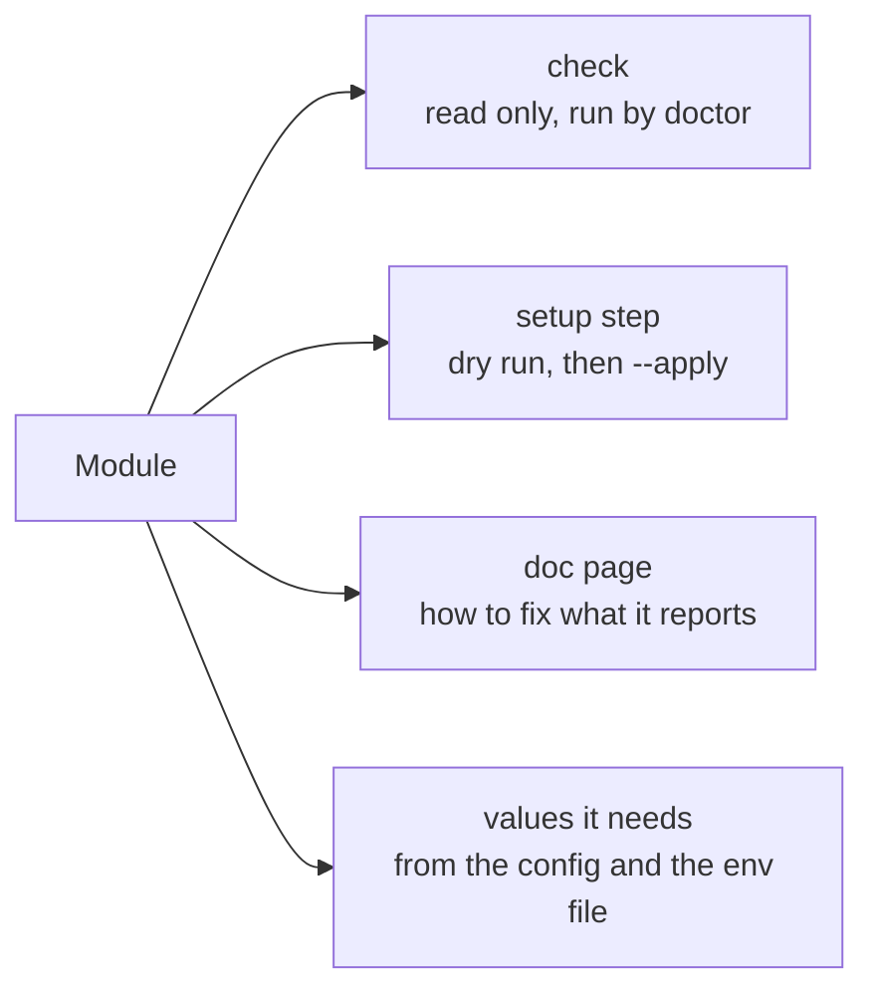

## Modules

Everything setupwise knows about lives in a **module**: one service the project depends on. Each module has the same parts:

| Module                            | Checks                                                  | Sets up                       |
| --------------------------------- | ------------------------------------------------------- | ----------------------------- |
| [tools](../modules/tools.mdx)     | Node.js version, command-line tools                     | Nothing: it says what to install |
| [env](../modules/env.mdx)         | Required keys, keys by feature, what `.env.example` lists | Nothing                     |
| [github](../modules/github.mdx)   | Variables, secrets, environment secrets, labels, branches | Variables and labels        |
| [gcp](../modules/gcp.mdx)         | Secret Manager values per environment                   | Secret values from `.env.<environment>` |

A module runs only when the project uses it: `github` needs a `github` section in the config, `gcp` a `gcp` section. Your own modules go in `modules` and run after the built-in ones ([Write a module](../guides/writing-a-module.mdx)).

## The output

Every line starts with one of four marks, so a long report is easy to scan:

| Mark | Means                                                   |
| ---- | ------------------------------------------------------- |
| `✓`  | Fine                                                    |
| `!`  | Worth a look: a part not set up yet, or skipped         |
| `✖`  | Must be fixed. `doctor` and `setup` exit with 1         |
| `+`  | A change. With `(dry run)`, a change that wasn't made   |

## Where values come from

1. The process environment.
2. The env file named by `envFile` (`.env` by default), next to the config.
3. For cloud secrets, `.env.<environment>`, such as `.env.staging`. These files are gitignored.
4. Fallbacks written in the config, for values that aren't secret, such as a public URL.

## What it never does

- Print a secret value.
- Change anything without `--apply`.
- Delete anything. Setup steps only create and update.
