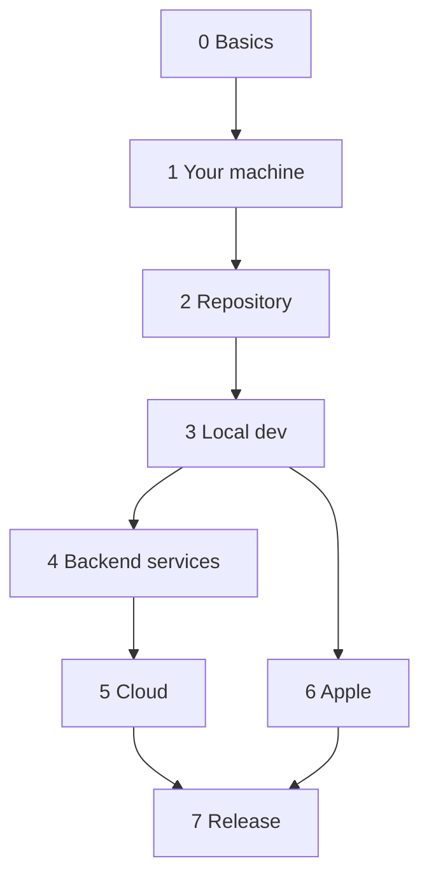

These docs are for anyone who builds or runs the project: a new developer, or the account holder setting up a service. Every page is a Markdown file in `apps/docs/content/`, changed in the same pull request as the code it describes.

<Cards>
  <Card title="How it fits together" href="/start-here">
    The apps, the services they talk to, and who deploys what. Start here.
  </Card>
  <Card title="Quick start" href="/start-here/quick-start">
    Run the app, the API and the website on your computer.
  </Card>
  <Card title="Setup, step by step" href="/setup">
    Eight phases, in order: accounts, keys, cloud, Apple, release.
  </Card>
  <Card title="Reference" href="/reference/commands">
    Every command, environment variable, secret and workflow.
  </Card>
</Cards>

## The path from zero to the App Store

Each phase needs the ones before it. Phases 4 to 6 can overlap once you run locally. Apple's developer account can take a few days to be approved: start it on day one.

## Sections

- **Start here**: what the project is, a quick start, and the accounts you'll need.
- **Setup, step by step**: one page per phase. Each step says where to click, what it gives you and where the value goes, and each page ends with a check (`pnpm doctor`).
- **Reference**: commands, environment variables and secrets, the GitHub workflows, and the problems we already hit with their fixes.
- **The project**: architecture and coding conventions.
