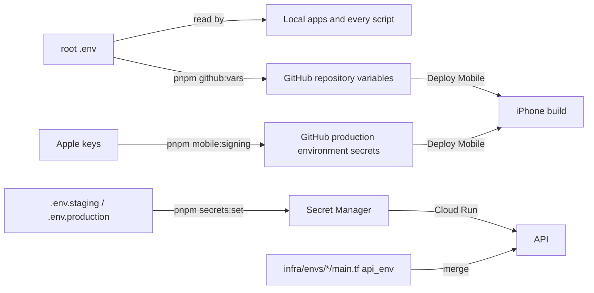

## Root `.env`

Declared once in `.env.example`, which explains each one. Never committed.

| Group             | Variables                                                                                                                                                                       | Needed for                         |
| ----------------- | ------------------------------------------------------------------------------------------------------------------------------------------------------------------------------- | ---------------------------------- |
| Mobile build      | `EXPO_PUBLIC_APP_NAME`, `APP_BUNDLE_ID`, `APPLE_TEAM_ID`, `EXPO_PUBLIC_API_URL`, `EXPO_PUBLIC_WEB_URL`                                                                          | The app                            |
| Sign-in           | `EXPO_PUBLIC_GOOGLE_IOS_CLIENT_ID`, `EXPO_PUBLIC_GOOGLE_IOS_URL_SCHEME`                                                                                                         | The Google button                  |
| Monitoring        | `EXPO_PUBLIC_SENTRY_DSN`                                                                                                                                                        | Crash reports                      |
| Website           | `NEXT_PUBLIC_META_PIXEL_ID`                                                                                                                                                     | Tracking (optional)                |
| Local API         | `API_PORT`, `API_URL`, `API_KEY`, `AUTH_SECRET`, `DATABASE_URL`, `TEST_DATABASE_URL`, `RESEND_API_KEY`, `RESEND_FROM`, `GOOGLE_OAUTH_CLIENT_IDS`, `APPLE_SIGN_IN_IOS_BUNDLE_ID` | The API on your computer           |
| Google Cloud      | `GCP_PROJECT_ID`                                                                                                                                                                | `infra:*`, `secrets:set`, `doctor` |
| Tooling           | `TURBO_TOKEN`, `TURBO_TEAM`                                                                                                                                                     | Optional                           |

`pnpm doctor` lists the missing ones by what they unlock (`env` in `setupwise.config.ts`). Apple keys for `pnpm mobile:signing` can also live in another file named by `SIGNING_ENV_SOURCE`.

## API secrets in the cloud

Named `<NAME>_<ENVIRONMENT>` in Secret Manager: `DATABASE_URL_STAGING`, `AUTH_SECRET_PRODUCTION` and so on. Values come from `.env.staging` / `.env.production` through `pnpm secrets:set`.

| Secret                    | Kind                     | Notes                                      |
| ------------------------- | ------------------------ | ------------------------------------------ |
| `DATABASE_URL`            | Required                 | The API doesn't start without it           |
| `AUTH_SECRET`             | Required                 | Different in each environment              |
| `API_KEY`                 | Required                 | Different in each environment              |
| `RESEND_API_KEY`          | Optional                 | Read once listed in `api_optional_secrets` |
| `GOOGLE_OAUTH_CLIENT_IDS` | Optional                 | Read once listed in `api_optional_secrets` |
| `REDIS_URL`               | Created outside OpenTofu | `REDIS_URL_STAGING`, `REDIS_URL_PROD`      |

Plain settings that aren't secret (`RESEND_FROM`, `APPLE_SIGN_IN_IOS_BUNDLE_ID`, the API address) are in `api_env` in `infra/envs/<env>/main.tf`.

## GitHub

| Where                            | Names                                                                                                                                                                                                                                               | Set by                |
| -------------------------------- | --------------------------------------------------------------------------------------------------------------------------------------------------------------------------------------------------------------------------------------------------- | --------------------- |
| Repository variables             | `GCP_PROJECT_ID`, `GCP_WIF_PROVIDER`                                                                                                                                                                                                                | `pnpm infra:init`     |
| Repository variables             | `API_URL_STAGING`, `API_URL_PRODUCTION`, `WEB_URL_STAGING`, `WEB_URL_PRODUCTION`, `EXPO_PUBLIC_GOOGLE_IOS_CLIENT_ID`, `EXPO_PUBLIC_GOOGLE_IOS_URL_SCHEME`, `EXPO_PUBLIC_SENTRY_DSN` | `pnpm github:vars`    |
| Repository variable              | `APP_BUNDLE_ID`                                                                                                                                                                                                                                     | `pnpm mobile:signing` |
| `production` environment secrets | `APPLE_ID`, `APPLE_TEAM_ID`, `APP_STORE_CONNECT_KEY_ID`, `APP_STORE_CONNECT_ISSUER_ID`, `APP_STORE_CONNECT_PRIVATE_KEY`, `FASTLANE_MATCH_PASSWORD`, `MATCH_GIT_URL`, `SSH_PRIVATE_KEY`                                                              | `pnpm mobile:signing` |
| Repository secrets               | `TURBO_TOKEN`, `TURBO_TEAM`                                                                                                                                                                                                                         | By hand (optional)    |
