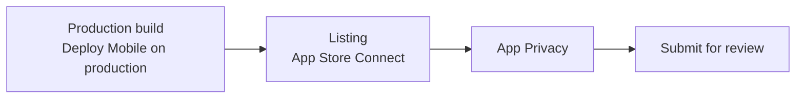

<Steps>
<Step>

### Build from `production`

Merge `main` into `production` (a pull request), then Actions → **Deploy Mobile (iOS)** → Run workflow on `production`.

</Step>
<Step>

### Fill the listing

App Store Connect → the app → the version: the description, keywords, support and privacy URLs (the website's `/support` and `/privacy`), the category, the age rating and screenshots (6.9" iPhone). Fastlane `deliver` can upload them from the repository once you have them.

</Step>
<Step>

### Answer App Privacy

App Store Connect → the app → App Privacy. Say what the app collects: with the starter, the email address and the user's content, linked to the user, for app functionality.

</Step>
<Step>

### Submit

Pick the build on the version page, then **Add for Review** → **Submit to App Review**. Give App Review a demo account that works in production.

</Step>
</Steps>

<Callout type="success" title="Check it">
  App Store Connect shows the version as **Waiting for Review**.
</Callout>
