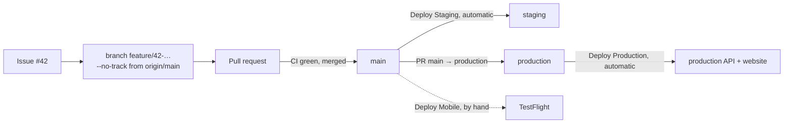

<Steps>
<Step>

### One branch and one pull request per issue

Pick an issue, then branch from `origin/main` without tracking it:

```sh
git switch -c feature/42-short-words --no-track origin/main
git push -u origin feature/42-short-words
```

`feature/` for new work, `hotfix/` for a fix to something already shipped. More: [Git and CI](../conventions/git-and-ci.md).

</Step>
<Step>

### Schema changes

Change the Prisma schema only. A person writes the migration with `pnpm db:migrate`; scripts and agents never do. Label the pull request `migration`. CI checks the migrations match the schema, and each deploy applies them before the new API starts.

</Step>
<Step>

### Ship

Merging into `main` deploys staging. A pull request from `main` into `production` deploys production. Phone builds stay manual: Deploy Mobile on the branch you want.

</Step>
<Step>

### Roll back

Revert the pull request on `main` (or `production`) and merge the revert: the deploy ships the previous code. A migration is never undone by a deploy; write a new one.

</Step>
</Steps>
