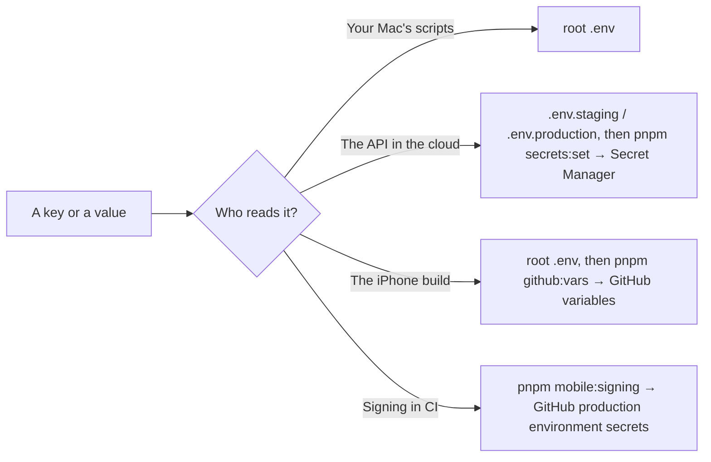

Open the accounts in this order. Prices change, so check each provider's page; "free tier" means the project fits in it today.

| Service                      | What it's for                                                | Cost                          | Set up in                                                              |
| ---------------------------- | ------------------------------------------------------------ | ----------------------------- | ---------------------------------------------------------------------- |
| GitHub                       | The code, pull requests, CI and every deploy                 | Free                          | [2 Repository](../setup/2-repository.mdx)                              |
| Google Cloud                 | Runs the API and the website (Cloud Run), holds the secrets  | Pay per use, billing required | [5 Cloud](../setup/5-cloud.mdx)                                        |
| CockroachDB Cloud            | The database, one per environment                            | Free tier                     | [4 Backend services](../setup/4-backend-services.mdx)                  |
| A Redis host                 | Rate limits shared by the API's instances                    | Free tier                     | [4 Backend services](../setup/4-backend-services.mdx)                  |
| Resend                       | Emails the sign-in codes                                     | Free tier                     | [4 Backend services](../setup/4-backend-services.mdx)                  |
| Google Cloud Console (OAuth) | "Continue with Google"                                       | Free                          | [4 Backend services](../setup/4-backend-services.mdx)                  |
| A DNS provider (Cloudflare)  | DNS for the domains                                          | Free tier                     | [0 Basics](../setup/0-basics.mdx)                                      |
| Apple Developer Program      | Signing, TestFlight, the App Store, Sign in with Apple       | 99 USD a year                 | [6 Apple](../setup/6-apple.mdx)                                        |
| Sentry (optional)            | Crash reports from the app                                   | Free tier                     | [4 Backend services](../setup/4-backend-services.mdx)                  |

<Callout type="warn" title="Start Apple on day one">
  Apple can take a few days to approve a new developer account. Enroll before
  anything else: [6 Apple](../setup/6-apple.mdx).
</Callout>

## Where each key ends up

Keys never go in the code. Each one has one home:

The full list, variable by variable: [Environment and secrets](../reference/environment.mdx).
