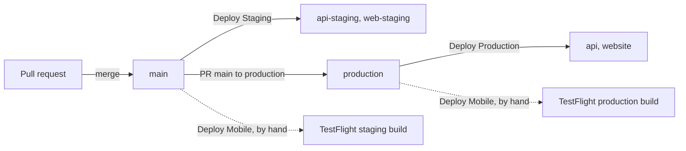

The project is one repository with the iPhone app, the API, the website and the packages they share. The app signs in to the API and keeps the user's data there; the **notes** feature is the example that goes through every layer.

## The big picture

Press **Play** to walk through it, or pick a step. Solid boxes are ours; dashed boxes are outside services.

<FlowDiagram
  height={440}
  nodes={[
    { id: 'mac', label: 'Your Mac', note: 'setupwise, infra', x: 0, y: 0, kind: 'ours' },
    { id: 'app', label: 'iPhone app', note: 'Expo', x: 0, y: 170, kind: 'ours' },
    { id: 'gh', label: 'GitHub Actions', note: 'CI and deploys', x: 0, y: 360, kind: 'ours' },
    { id: 'secrets', label: 'Secret Manager', note: 'Google Cloud', x: 230, y: 0, kind: 'ours' },
    { id: 'web', label: 'Website', note: 'Next.js on Cloud Run', x: 230, y: 360, kind: 'ours' },
    { id: 'api', label: 'API', note: 'tRPC on Cloud Run', x: 460, y: 60, kind: 'ours' },
    { id: 'store', label: 'TestFlight · App Store', note: 'Apple', x: 460, y: 280, kind: 'outside' },
    { id: 'db', label: 'Database', note: 'CockroachDB', x: 690, y: 0, kind: 'outside' },
    { id: 'redis', label: 'Redis', note: 'rate limits', x: 690, y: 110, kind: 'outside' },
    { id: 'resend', label: 'Resend', note: 'email codes', x: 690, y: 220, kind: 'outside' },
  ]}
  edges={[
    { from: 'app', to: 'api', label: 'tRPC' },
    { from: 'api', to: 'db' },
    { from: 'api', to: 'redis' },
    { from: 'api', to: 'resend' },
    { from: 'secrets', to: 'api' },
    { from: 'mac', to: 'secrets', label: 'secrets:set' },
    { from: 'gh', to: 'api', label: 'deploy' },
    { from: 'gh', to: 'web', label: 'deploy' },
    { from: 'gh', to: 'store', label: 'build' },
  ]}
  steps={[
    {
      caption: 'The app signs in to the API and reads and writes the user’s data through tRPC.',
      edges: ['app>api'],
    },
    {
      caption:
        'The API keeps accounts and data in the database, shares rate limits through Redis and sends sign-in codes with Resend.',
      edges: ['api>db', 'api>redis', 'api>resend'],
    },
    {
      caption:
        'Cloud Run gives the API its secrets from Secret Manager. You fill them from your Mac with pnpm secrets:set.',
      edges: ['secrets>api', 'mac>secrets'],
    },
    {
      caption:
        'Merging a pull request deploys the API and the website. Phone builds go to TestFlight when you run Deploy Mobile.',
      edges: ['gh>api', 'gh>web', 'gh>store'],
    },
  ]}
/>

## What is in the repository

| Folder                   | What it is                                                                 |
| ------------------------ | -------------------------------------------------------------------------- |
| `apps/mobile`            | The iPhone app (Expo, React Native)                                        |
| `apps/web`               | The website: landing page, privacy policy, terms, support                  |
| `apps/api`               | Accounts and the notes example (Fastify, tRPC, Prisma)                     |
| `apps/workshop`          | Storybook in the browser for every UI component                            |
| `apps/docs`              | This site                                                                  |
| `packages/ui`            | The UI kit both the app and the website use                                |
| `packages/design-tokens` | Colors, radii, fonts                                                       |
| `packages/common`        | Shared schemas and the brand                                               |
| `packages/database`      | The Prisma schema and database client                                      |
| `infra/`                 | Google Cloud, described with OpenTofu                                      |
| `setupwise.config.ts`    | What the project needs outside its code, checked by `pnpm doctor`          |
| `.github/workflows/`     | CI and the deploys                                                         |

More detail: [Architecture](../architecture/index.md).

## Two environments

**Staging** follows the `main` branch and **production** follows the `production` branch. Each has its own API, website, database and secrets. Phone builds are the exception: both are builds of one TestFlight app, and the branch you build from decides which API the build calls.

